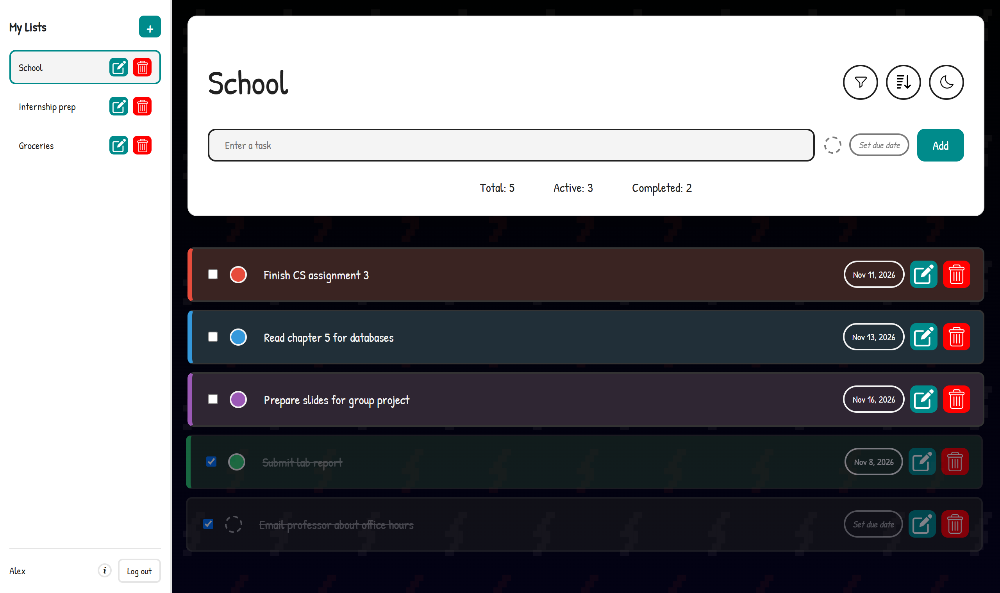
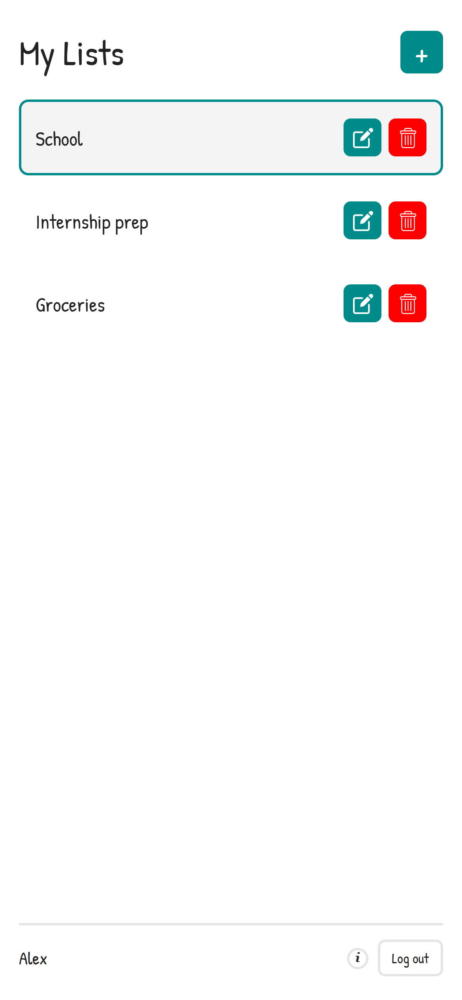
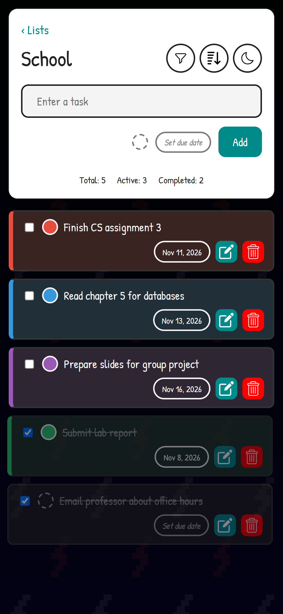
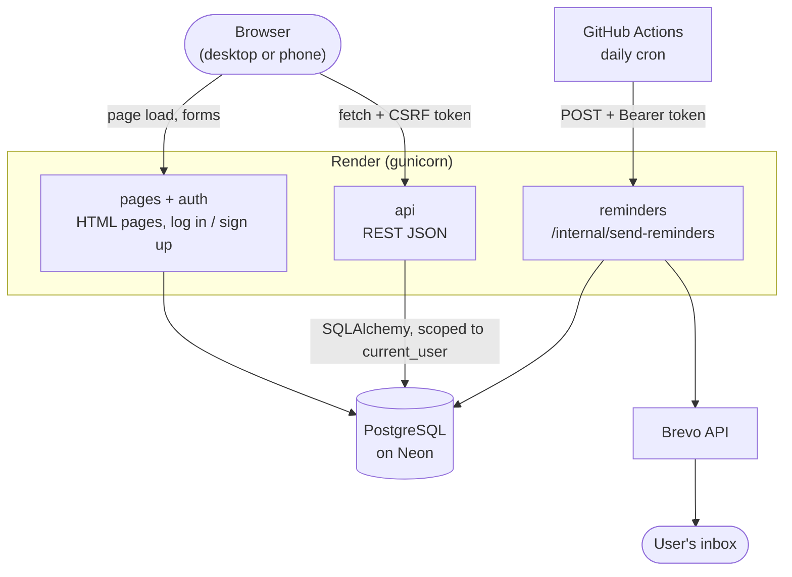
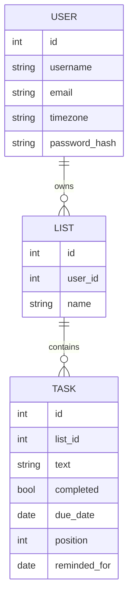

# To-do List

A full-stack to-do list app with user accounts, multiple lists and daily email reminders for tasks due tomorrow. Built with Flask, SQLAlchemy and PostgreSQL, with a vanilla JavaScript frontend that works on desktop and phone.

It started as a plain HTML/CSS/JS app that saved everything in `localStorage`. I rebuilt the backend in Flask so the data syncs across devices.

**Live demo:** [todolist-xaw3.onrender.com](https://todolist-xaw3.onrender.com) (free plan, the first load can take up to a minute)



<p align="center">
  
  &nbsp;&nbsp;
  
</p>

## Features

**Tasks and lists**
- Multiple lists: create, rename and delete them from the sidebar
- Add, edit, complete and delete tasks
- Color labels and due dates
- Sort by manual order, due date or color, and filter by All / Active / Completed
- Drag and drop to reorder (saved on the server)
- Live counter of total, active and completed tasks
- Warning before adding a duplicate task
- Dark mode
- Phone layout: lists first, tap one to open it, the back gesture returns to the lists

**Accounts**
- Sign up and log in, each user only sees their own data
- Display name, password change
- Optional email with a verification link

**Email reminders**
- Once a day, users with a verified email get one email listing their unfinished tasks due tomorrow, worked out in their own timezone
- Triggered by a scheduled GitHub Actions workflow, sent through Brevo
- Never sends the same reminder twice

## Tech stack

| Part | Tools |
|---|---|
| Backend | Python, Flask, REST API (JSON) |
| Database | SQLAlchemy, Flask-Migrate (Alembic), PostgreSQL on Neon, SQLite locally |
| Auth and security | Flask-Login, Werkzeug password hashing, Flask-WTF (CSRF), Flask-Limiter |
| Frontend | HTML, CSS, vanilla JavaScript (no framework) |
| Email | Brevo API, itsdangerous signed links |
| Testing | pytest, pytest-cov (87% coverage) |
| Deployment | Render (gunicorn), Neon, GitHub Actions |

## Architecture



**How a request goes**

1. The browser loads `/` once. Flask renders `index.html` with the CSRF token in a `<meta>` tag.
2. After that the JavaScript only talks to `/api/...` with `fetch`, sending the token in an `X-CSRFToken` header.
3. Flask-Login reads the session cookie. Every query filters by `current_user.id`, so another user's ids return 404.
4. The UI updates right away (optimistic update). If the save fails, a message asks the user to reload the page.

**Code layout**

- `create_app()` builds the app, so tests can make a fresh one with their own config
- 4 blueprints: `pages`, `auth`, `api` (under `/api`) and `reminders`
- Database changes go through Flask-Migrate, and Render runs `db upgrade` on every deploy

**Data model**



Deleting a user deletes their lists, and deleting a list deletes its tasks. `position` keeps the drag and drop order, and `reminded_for` stops the same reminder from being sent twice.

**Daily reminders**

GitHub Actions calls `/internal/send-reminders` once a day with a secret token. The app finds unfinished tasks due tomorrow in each user's timezone, sends one email per user through Brevo and saves `reminded_for`. Using an outside scheduler means the app doesn't need a background worker, which Render's free plan doesn't have.

## Security

- Passwords are stored as salted hashes, never in plain text
- Every database lookup is scoped to the logged-in user. Someone else's list or task returns 404, so ids can't be guessed (IDOR)
- CSRF tokens on every form and API call, plus `SameSite=Lax`, `HttpOnly` and `Secure` cookies
- Rate limits on login, sign up, password change and emails
- All secrets come from environment variables, the app refuses to start without `SECRET_KEY`
- The reminder endpoint needs a secret token, compared in constant time

## Run it locally

Needs Python 3.12 or newer.

```powershell
git clone https://github.com/BenNguyen0204/ToDoList.git
cd ToDoList
python -m venv .venv
.venv\Scripts\Activate.ps1          # macOS / Linux: source .venv/bin/activate
pip install -r requirements-dev.txt
```

Copy `.env.example` to `.env` and set at least `SECRET_KEY`:

```powershell
python -c "import secrets; print(secrets.token_hex(32))"
```

Leave `DATABASE_URL` empty to use a local SQLite file, and `BREVO_API_KEY` empty to have emails printed in the terminal instead of sent.

```powershell
flask --app wsgi db upgrade   # create the tables
flask --app wsgi run          # http://127.0.0.1:5000
```

Send the reminder emails by hand:

```powershell
flask --app wsgi send-reminders
```

## Tests

```powershell
pytest              # run all tests
pytest --cov=app    # with coverage
```

Each test gets a fresh app and a temporary database. They cover login protection, task and list CRUD, input validation, users not being able to read or change each other's data, password change, email verification and the reminder job.

## API

All routes need a logged-in user and return JSON.

| Method | URL | What it does |
|---|---|---|
| `GET` | `/api/lists` | All of my lists with their tasks |
| `POST` | `/api/lists` | Create a list |
| `PATCH` | `/api/lists/<id>` | Rename a list |
| `DELETE` | `/api/lists/<id>` | Delete a list and its tasks |
| `POST` | `/api/lists/<id>/tasks` | Add a task |
| `PUT` | `/api/lists/<id>/order` | Save the drag and drop order |
| `PATCH` | `/api/tasks/<id>` | Edit a task (text, completed, color, due date) |
| `DELETE` | `/api/tasks/<id>` | Delete a task |
| `GET` / `PATCH` | `/api/account` | Read or update display name and timezone |
| `PUT` | `/api/account/email` | Set or remove the email, sends a verification link |
| `POST` | `/api/account/email/resend` | Send the verification link again |
| `POST` | `/api/account/password` | Change password |

## Project structure

```text
app/
  __init__.py      app factory, config, security settings
  models.py        User, TodoList, Task
  api.py           REST API
  auth.py          sign up, log in, log out, email verification
  reminders.py     daily reminder job
  mailer.py        sending email, signed verification links
  pages.py         main page, /healthz
  templates/       HTML
  static/          CSS, JavaScript, images
migrations/        database migrations
tests/             pytest suite
.github/workflows/ daily reminder schedule
wsgi.py            entry point for gunicorn
```

## Deployment

Runs on Render's free plan with a Neon PostgreSQL database.

- Build: `pip install -r requirements.txt`
- Start: `flask --app wsgi db upgrade && gunicorn wsgi:app --workers 1 --threads 4 --bind 0.0.0.0:$PORT`
- Health check: `/healthz`
- Environment variables: see `.env.example`

## What's next

- Run the tests automatically on every push
- Password reset through the verified email
- Drag and drop on touch screens
